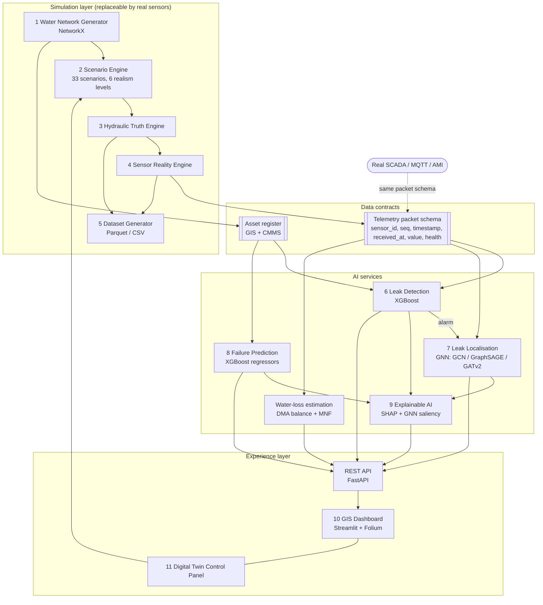
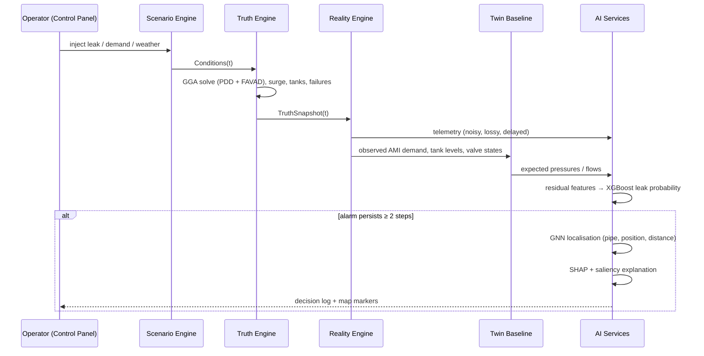

# AquaTwin AI: System Architecture

## 1. Design principle: CAUSE → PHYSICS → OBSERVATION

```mermaid
flowchart LR
    subgraph CAUSE["CAUSE (Scenario Engine)"]
        S1[Demand patterns<br/>weather, weekends]
        S2[Leaks / bursts<br/>hazard-field located]
        S3[Infrastructure faults<br/>aging, blockage, valves, pump trip]
        S4[Environment<br/>rain, settlement, construction, traffic]
    end
    subgraph PHYSICS["PHYSICS (Hydraulic Truth Engine)"]
        H1[GGA solver<br/>Hazen-Williams + pumps + tanks]
        H2[Pressure-driven demand]
        H3[FAVAD leak emitters<br/>pipe split at leak point]
        H4[Joukowsky transients]
        H5[Deterioration + stress-strength failure]
    end
    subgraph OBS["OBSERVATION (Sensor Reality Engine)"]
        O1[Noise, quantisation]
        O2[Drift / bias / frozen / failure]
        O3[Bursty packet loss, latency, duplicates]
    end
    CAUSE --> PHYSICS --> TRUTH[(Ground-Truth World)]
    TRUTH --> OBS --> TEL[(Telemetry)]
    TEL --> ING[Ingestion<br/>dedup + latency gate]
    ING --> TWIN[Twin Baseline<br/>expected state]
    ING --> AI[AI Services]
    TWIN --> AI
    TRUTH -. scoring only .-> EVAL[Evaluation]
    AI --> EVAL
```



Randomness exists in exactly three places: sensors, communications, and environmental uncertainty
(consumer behaviour, the time at which a structurally stressed pipe actually fails). Hydraulic
states are **never** sampled. They are solved from the network equations. The automated test
`test_causality_no_randomness_in_hydraulic_truth` proves this. It runs the same cause through two
different sensor random streams and checks that the truth is bit-identical.

## 2. Component architecture



## 3. Runtime sequence (one 15-minute step in the live twin)



## 4. Module catalogue

| # | Module | Package | Responsibility | Key technical decision |
|---|---|---|---|---|
| 1 | Water Network Generator | `aquatwin/network/` | City street grid → engineered pipe network with DMAs, reservoir → pumping station → elevated tanks | Pipes are **sized hydraulically** (supply tree + v ≤ 1 m/s), materials follow installation era, and the repair history is *simulated* from the hazard model |
| 2 | Scenario Engine | `aquatwin/scenarios/` | Event timeline → per-step physical `Conditions`; catalogue of 33 scenarios; realism levels 0-5 | Scenarios specify causes only. Unspecified leak locations are sampled from the physics hazard field, never uniformly |
| 3 | Hydraulic Truth Engine | `aquatwin/physics/`, `aquatwin/truth/` | Extended-period simulation: GGA solver, PDD, FAVAD leaks, pumps and tank controls, Joukowsky surge, deterioration, stress-strength failures | Same algorithm as EPANET 2 (Todini-Pilati). Leaks split the pipe, so the true location is physical. Mass-balance audit runs every step |
| 4 | Sensor Reality Engine | `aquatwin/sensors/` | Placement (k-center), noise, faults, Gilbert-Elliott comms, raw packets | Sensor health is partially observable (bias is undetectable, as in reality) |
| 5 | Dataset Generator | `aquatwin/data/` | Episodes → `pipes_timeseries` (spec schema), node/system/events/telemetry tables, localisation sweep, asset-history panel | Truth and observation are stored side by side with provenance tags (`schema.json`) |
| 6 | Leak Detection | `aquatwin/models/detection.py` | XGBoost on twin residuals → leak probability per pipe → network alarm with persistence | Episode-grouped out-of-fold threshold tuning; label-leakage guard |
| 7 | GNN Localisation | `aquatwin/models/localization.py` | Edge classification + position regression on the pipe graph | Physics-informed: hydraulic conductance as GCN edge weight, and leak-signature correlation as an edge prior |
| 8 | Failure Prediction | `aquatwin/models/failure.py` | Annual failure probability + remaining useful life | Trained on noisy inspection proxies; hidden truth drives targets. GroupKFold by pipe |
| 9 | Explainable AI | `aquatwin/xai/` | TreeSHAP, natural-language reasons, GNN gradient×input saliency | Every explanation can be audited against the causal event log |
| 10 | GIS Dashboard | `dashboard/app.py` | Map layers, filters, timeline and scenario playback, asset popups, XAI, evaluation | Ground-truth layer is a toggle, absent in a real deployment |
| 11 | Digital Twin Control Panel | `aquatwin/twin/session.py` + dashboard sidebar + API | Start, inject leak, burst, or sensor failure, change demand or weather, replay, view AI decisions | One session object backs both the UI and the REST API |
| - | Water-loss service | `aquatwin/services/water_loss.py` | DMA water balance + Minimum Night Flow | IWA/AWWA top-down method, computed only from observations |
| - | MLOps | `aquatwin/mlops/`, `pipeline.py`, `evaluation/` | Training pipeline, registry with data lineage, level-based evaluation | Optional MLflow hook, zero mandatory infrastructure |

## 5. Folder structure

```
AquaTwin/
├── aquatwin/                      # Python package
│   ├── config.py                  # every tunable, YAML-overridable
│   ├── simulation.py              # SimulationRun: cause → physics → observation → twin baseline
│   ├── pipeline.py                # training pipeline + report rendering
│   ├── cli.py / __main__.py       # python -m aquatwin generate|train|evaluate|all|api|dashboard|scenarios
│   ├── network/
│   │   ├── generator.py           # city network synthesis (NetworkX)
│   │   ├── materials.py           # material engineering properties
│   │   ├── model.py               # WaterNetwork: tables, distances, GeoJSON, EPANET .inp export
│   │   └── calibration.py         # pressure-cycle calibration against simulation
│   ├── physics/
│   │   ├── hydraulics.py          # GGA solver (PDD + FAVAD emitters)
│   │   ├── demand.py              # diurnal / weekly / weather demand physics
│   │   └── degradation.py         # corrosion, roughness, hazard, health, RUL, Barlow strength
│   ├── scenarios/
│   │   ├── events.py              # Event, LeakSpec, Conditions
│   │   ├── catalog.py             # 33 scenarios with rules
│   │   └── engine.py              # ScenarioEngine, realism levels, episode composer
│   ├── truth/
│   │   ├── builder.py             # per-step hydraulic model (leak pipe splitting, tank rule)
│   │   └── engine.py              # TruthEngine (ground truth) + TwinBaseline (expectation)
│   ├── sensors/
│   │   ├── registry.py            # sensor placement
│   │   ├── reality.py             # observation model
│   │   └── ingest.py              # telemetry dedup / latency gate (real-sensor boundary)
│   ├── data/
│   │   ├── generator.py           # dataset generator + localisation sweep
│   │   ├── assets.py              # pipe-year asset history panel
│   │   └── schema.py              # column provenance
│   ├── models/
│   │   ├── features.py            # residual, contrast, proximity, balance, temporal features
│   │   ├── detection.py           # XGBoost detector + alarm logic + metrics
│   │   ├── localization.py        # GNNs (GCN/SAGE/GAT) + sensitivity baseline + metrics
│   │   └── failure.py             # failure risk + RUL regressors
│   ├── services/water_loss.py     # DMA balance, MNF
│   ├── xai/explain.py             # SHAP + narratives
│   ├── twin/session.py            # live digital twin with AI in the loop
│   ├── evaluation/framework.py    # realism level 0-5 evaluation
│   ├── mlops/registry.py          # model registry + lineage
│   └── api/main.py                # FastAPI
├── dashboard/app.py               # Streamlit + Folium GIS dashboard & control panel
├── tests/                         # physical-truth contract + engine tests (pytest)
├── configs/                       # default.yaml, quick.yaml
├── docs/                          # this documentation
├── reports/                       # training + evaluation reports (generated)
├── data/generated/                # dataset (generated, git-ignored)
├── artifacts/models/              # trained models + registry (generated, git-ignored)
├── Dockerfile, docker-compose.yml, Makefile, requirements.txt, pyproject.toml
```

## 6. Why the architecture survives real sensors

The AI services never import the simulator. They consume only:

1. **Telemetry packets** (`sensor_id, seq, timestamp, received_at, value, health`), the format
   emitted by `RealityEngine` and accepted by `POST /ingest/telemetry`.
2. **The asset register**: GIS pipe attributes plus maintenance history.
3. **The twin baseline**, a hydraulic model driven by observed AMI demand, tank levels and
   valve states. A utility gets this by calibrating the exported `network.inp` in EPANET or WNTR.

A municipality connects its SCADA historian or MQTT broker to the ingestion endpoint, imports its
GIS layer in place of the generator, and keeps every AI service, the dashboard and the API unchanged.
