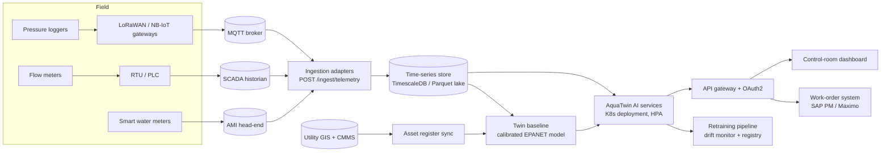

# Deployment, Docker, API and MLOps

## 1. Quick start

```bash
pip install -r requirements.txt          # Python 3.10+
python -m aquatwin all                   # simulate data, train models, evaluate L0-L5 (~20-30 min CPU)
python -m aquatwin --config configs/quick.yaml all   # 3-5 minute smoke version
streamlit run dashboard/app.py           # GIS dashboard + control panel  -> http://localhost:8501
uvicorn aquatwin.api.main:app            # REST API                       -> http://localhost:8000/docs
pytest -q                                # physical-truth contract + engine tests
```

## 2. Docker

```bash
docker compose build
docker compose --profile batch run --rm pipeline   # data + training + evaluation into ./data ./artifacts ./reports
docker compose up api dashboard                     # :8000 API, :8501 dashboard
```

A single CPU image (`python:3.11-slim` + CPU PyTorch) serves three roles:

| Service | Command | Port | Notes |
|---|---|---|---|
| `pipeline` (batch profile) | `python -m aquatwin all` | n/a | Run nightly (or on new data) to retrain; writes the registry |
| `api` | `uvicorn aquatwin.api.main:app` | 8000 | Stateless apart from the live twin session; health check `/health` |
| `dashboard` | `streamlit run dashboard/app.py` | 8501 | Reads the same volumes |

## 3. Target production deployment (municipal utility)



* **Scaling:** one GGA solve takes about 5 ms for 125 nodes. City-scale networks (50k nodes) are
  split per DMA or pressure zone and solved in parallel. The dependency-light core (NumPy/SciPy)
  runs anywhere. GNN inference is under 10 ms per snapshot on CPU.
* **Security:** API behind a gateway with OAuth2/OIDC. Read-only roles for viewers. Control-panel
  actions (injections) are disabled in production mode, so only real telemetry is accepted.
* **Monitoring:** data completeness per sensor (`/ingest/quality`), residual drift (twin calibration
  health), alarm rate, and model metrics in the registry.

## 4. REST API (`/docs` gives the OpenAPI UI)

| Method | Path | Purpose |
|---|---|---|
| GET | `/health` | Liveness + whether a simulation is running |
| GET | `/scenarios` | Scenario catalogue with rules |
| POST | `/simulation/start` | `{level, seed, start, hours}` starts a twin session |
| POST | `/simulation/step?n=4` | Advance n × 15 min; returns AI state per step |
| GET | `/simulation/state` | Time, pump, tank levels, demand, true loss, alarm |
| POST | `/inject/leak` | `{pipe_id?, category, position?, growth_per_hour}` |
| POST | `/inject/burst?pipe_id=` | Catastrophic burst |
| POST | `/inject/sensor-failure` | `{sensor_id?, mode: sensor_failure\|sensor_drift\|sensor_bias\|sensor_frozen}` |
| POST | `/control/demand` | `{factor, hours, land_use?}` |
| POST | `/control/weather` | `{temperature_offset, rainfall_mm_h, hours}` |
| POST | `/control/close-pipe/{pipe_id}` | Valve isolation |
| POST | `/scenarios/{name}/replay` | Replay a catalogue scenario from now |
| GET | `/events` | Event log with causal explanations |
| GET | `/ai/decisions` | Alarm, localisation and clear decisions with explanations |
| GET | `/ai/detection?top=10` | Current leak probabilities |
| GET | `/ai/localization` | Top-5 GNN candidates (pipe, position, distance, lat/lon) |
| GET | `/ai/failure-risk?top=20` | Predictive-maintenance ranking |
| GET | `/ai/water-loss` | DMA balance estimates |
| GET | `/network/geojson` | Network layer for any GIS client |
| GET | `/network/pipes/{pipe_id}` | Asset details |
| POST | `/ingest/telemetry` | **Real sensor feed**: list of `{sensor_id, seq, timestamp, received_at, value, health}` |
| GET | `/ingest/quality` | Completeness, duplicates, latency per sensor |

Example:

```bash
curl -X POST localhost:8000/simulation/start -H 'content-type: application/json' -d '{"level":4,"hours":24}'
curl -X POST localhost:8000/inject/leak -H 'content-type: application/json' -d '{"category":"large"}'
curl -X POST 'localhost:8000/simulation/step?n=8'
curl localhost:8000/ai/decisions
```

## 5. MLOps

* `pipeline.train_all` is deterministic given the config and seeds. The dataset manifest hash is
  stored with each model version in `artifacts/models/registry.json`. A new version becomes
  `production` and older ones are `archived`.
* `MLFLOW_TRACKING_URI` set: metrics are also logged to MLflow.
* Champion/challenger: compare `reports/evaluation_levels.csv` across versions before promotion.
* Retraining triggers: new asset-register snapshot, network topology change, twin residual drift,
  or a monthly schedule.
* With real data: the sweep remains a simulated augmentation source (sim-to-real). Real confirmed
  leaks from work orders are added as labelled episodes, and the realism-level suite remains the
  regression test for every model release.
