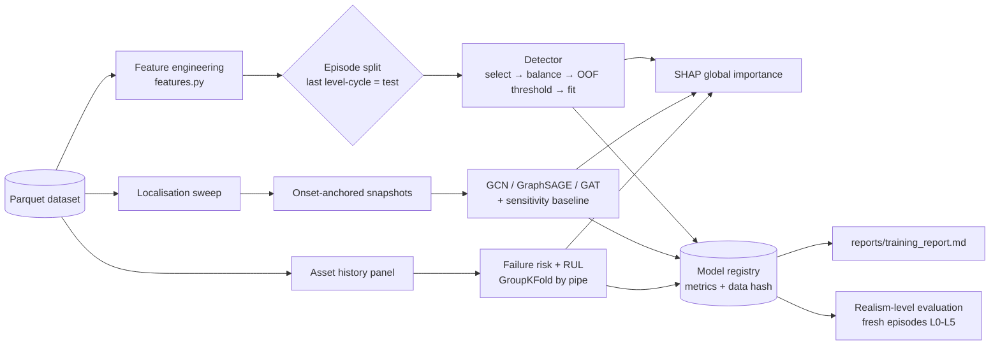
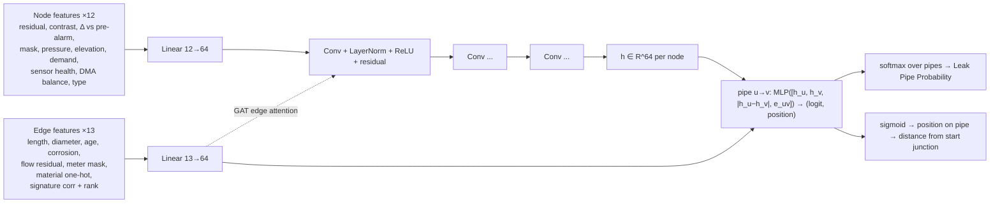

# AI Models: Feature Engineering, Training Pipeline, GNN Architecture, XAI

## 1. Training pipeline (`python -m aquatwin train` → `aquatwin/pipeline.py`)

**Splitting rules (no leakage):** splits are by *episode* for detection (consecutive 15-min rows are
highly autocorrelated), by *sweep sample* for the GNN, and by *pipe* for failure prediction (pipe-years
are autocorrelated). Test episodes are the last level cycle, so every realism level is represented.

## 2. Feature-engineering strategy (`aquatwin/models/features.py`)

| Family | Features | Why |
|---|---|---|
| Spec inputs | pressure, flow, demand, corrosion, pipe_health, sensor_health | As requested; raw pressure alone is dominated by elevation and demand |
| Model-based residuals | `res_start`, `res_end`, `res_local` = observed − twin expected | Removes elevation, demand and tank effects. Leaks become the dominant residual |
| Hydraulic proximity | `nbr_res`, `nbr_min`, `nbr_count` (sensors within 700 m network distance, weights 1/(d+50)) | Rule 5: closer sensors see stronger signatures. Gives unmonitored pipes evidence |
| Common-mode rejection | `net_median_res`, `nbr_contrast`, `gap_to_min`, `net_min_contrast` | A demand surge drops all residuals while a leak drops them locally (Leak + High Demand) |
| Cross-sectional rank | `contrast_rank`, `nbr_min_rank`, `flow_res_rank` | Is this pipe in the most anomalous region right now? |
| Flow | `flow_res`, `flow_res_rel` on metered pipes | A metered leaking pipe carries the leak flow directly |
| Water balance | `dma_ufw`, `dma_ufw_rel`, `dma_ufw_roll4` (DMA inflow − AMI) | Utility-standard top-down indicator, sensitive to small leaks at night |
| Temporal | `nbr_delta` (change vs 1-2 h ago), `nbr_roll4` | Removes static bias and model mismatch; detects onsets |
| Context and prior | hour_sin/cos, is_night, pipe_age, diameter, length, repairs, material | FAVAD night effect; hazard prior (Rules 3, 4, 6) |

Missing data stays NaN, and XGBoost learns default split directions. This matches packet loss and dead
sensors in production. No imputation leaks future information.

## 3. Leak detection (XGBoost)

1. **Feature selection:** a first model ranks features by total gain. Features covering 98% of the
   cumulative gain are kept (minimum 10). The report lists both kept and dropped features.
2. **Class balancing:** leaks are about 0.3% of rows. Negatives are under-sampled to 25:1, plus
   `scale_pos_weight`.
3. **Training data:** training episodes plus the physics sweep (hundreds of distinct leak locations,
   so the model cannot memorise "which pipes leaked").
4. **Validation:** 3-fold episode-grouped out-of-fold predictions. The F1-optimal pipe threshold and
   the network-alarm threshold are tuned on full-day episodes only.
5. **Alarm logic:** network alarm = max pipe probability ≥ threshold for 2 consecutive steps (30 min).
   This suppresses false alarms from single noisy readings.
6. **Metrics:** accuracy, precision, recall, F1, ROC-AUC, and PR-AUC at two granularities: per time
   step (network alarm) and per pipe × step. Also detection delay, hit@k (true pipe in the top-k
   ranked pipes), and recall by leak size.

## 4. GNN leak localisation (PyTorch Geometric)

* **Encoders compared:** GCN (with a physics-informed edge weight, hydraulic conductance
  `D^2.63 / L^0.54`), GraphSAGE (mean aggregation, inductive, robust to missing sensors), and GATv2
  (attention using edge features). There are 3 layers, hidden size 64, residual connections and
  LayerNorm. Optimiser: AdamW (lr 3e-3, cosine schedule), 60 epochs. The checkpoint with the best
  validation localisation error is kept.
* **Loss:** cross-entropy over the pipes of each snapshot (the target is the leak-flow share, so dual
  leaks are supported), plus 2 × L1 position loss on the leaking pipes.
* **Physics-informed hybrid:** each pipe's correlation between the current residual vector and its
  *simulated leak signature* (sensitivity matrix, one GGA solve per pipe) is an edge feature. The GNN
  learns corrections on top of classical model-based localisation.
* **Onset-anchored inference:** localisation runs when the alarm fires. Temporal features reference a
  frozen pre-alarm window, as in a control room.
* **Final prediction:** pipe id, fractional position, distance from the start junction (m), lat/lon,
  and the top-5 candidates with probabilities.
* **Metric:** localisation error in metres, measured as **network distance along pipes** between the
  predicted point and the nearest true leak (not straight-line distance). Also top-1/3/5, median, and
  the share within 100 m / 250 m.
* **Baseline:** the classical sensitivity-matrix correlation method (Pérez et al., 2011).

## 5. Failure prediction (predictive maintenance)

* Inputs: pipe_age, material, repair_count, corrosion (noisy inspection), pressure_cycles (noisy
  loggers), historical_leaks, diameter, length, mean_pressure.
* Targets: `failure_risk` (annual probability, learned on the logit scale) and `remaining_useful_life`
  (years until health < 35).
* Model: two `XGBRegressor`s with 5-fold GroupKFold by pipe. Metrics: MAE, RMSE and R², plus
  next-year break AUC and the share of breaks captured by the top-10% risk list (a
  capital-planning KPI).

## 6. Explainable AI

* **Why was a leak detected?** TreeSHAP on the detector at alarm time. The top contributions are
  converted to an operator sentence, for example: *"Pipe P118: leak probability 93% (ALARM) mainly
  because local pressure drop relative to the rest of the network = −1.8; DMA unaccounted-for flow
  = 9.4; ..."*.
* **Why is this pipe high risk?** TreeSHAP on the risk model (logit), for example age, corrosion
  and repairs.
* **Which sensors drove the GNN?** Gradient × input saliency on the residual features.
* **Global dashboards:** mean |SHAP| bars for detector and risk models. The diverging blue/red bars
  show per-decision contributions.
* **Causal audit:** in the twin, every explanation can be compared with the logged scenario event
  that caused the anomaly. Explanations are therefore *verifiable*, not just plausible.
